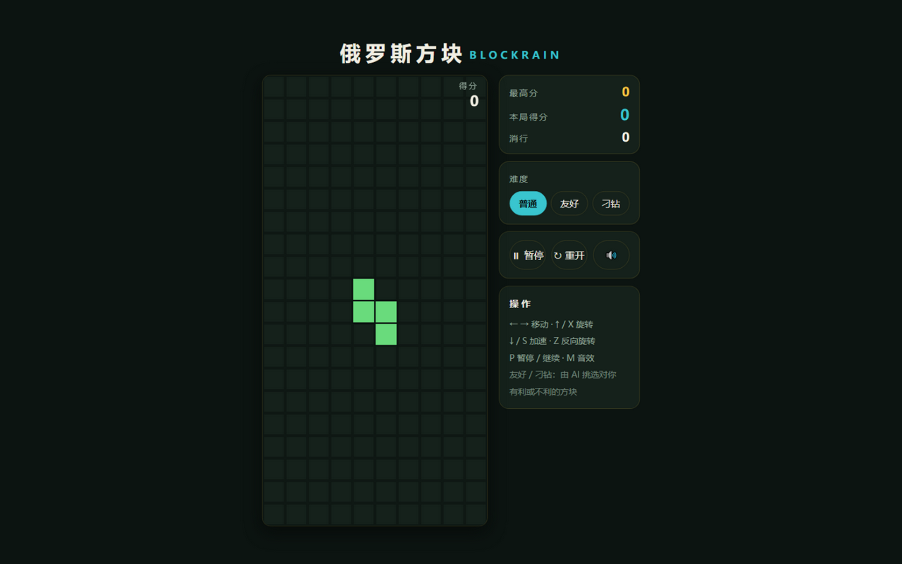
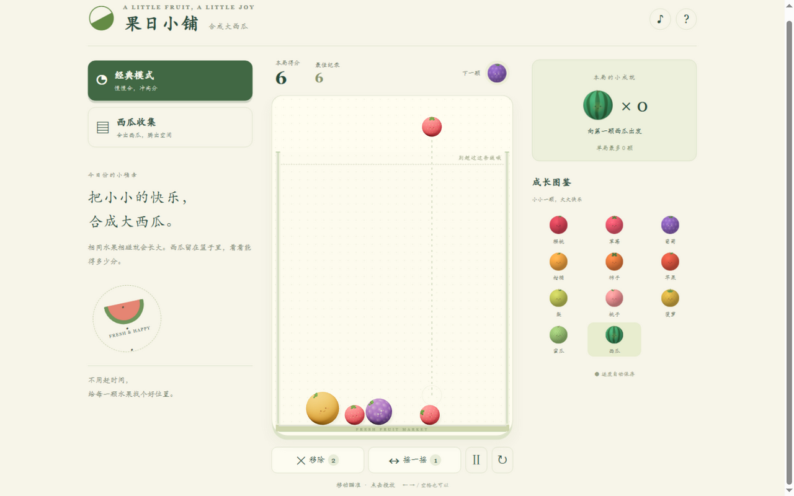

<div align="center">

# 🎮 游戏厅

[](https://github.com/Civinar-Riley/riley-game-hall/actions/workflows/deploy.yml)
[](https://vite.dev/)
[](https://developer.mozilla.org/zh-CN/docs/Web/JavaScript)
[](package.json)
[](https://www.gnu.org/licenses/gpl-3.0)

**多游戏合集 —— 一个大厅，8 款游戏随便选**

### [▶️ 进入游戏厅](https://civinar-riley.github.io/riley-game-hall/)

</div>

## 🕹️ 收录游戏

| 游戏 | 玩法 |
|------|------|
| 🃏 21 点 - 黑杰克 | 下注、要牌、加倍、分牌，40 个成就 |
| 💣 扫雷 | 经典扫雷，扫开所有安全格 |
| 🏇 赛马场 | 赛马竞速，看准马儿下注 |
| 🀄 连连看 | 把相同的牌全部配对消除 |
| 🃏 炸金花 | 3 张牌比大小，3 个 AI 陪你玩（还会唬人） |
| ⬡ 六边形消消乐 | Hextris 开源移植：旋转六边形接住落块，三连同色消除（已汉化） |
| 🧱 俄罗斯方块 | Blockrain 开源移植：经典七种方块消行得分，普通/友好/刁钻三种 AI 难度（已汉化） |
| 🍉 合成大西瓜 | 果日小铺：Three.js 立体水果、经典冲分 / 西瓜收集双模式、移除与摇一摇、分模式续玩、亮暗主题 |

## 📸 实机截图

| 大厅 | 21 点 | 炸金花 |
|------|------|------|
|  |  |  |

| 六边形消消乐 | 扫雷 | 赛马场 |
|------|------|------|
|  |  |  |

| 连连看 | 俄罗斯方块 | 合成大西瓜 |
|------|------|------|
|  |  |  |

## ✨ 特性

- 🖥️ **卡片墙首页**：深色赌场风，选游戏一键进
- 🔒 **沙箱隔离**：每个游戏跑在独立沙箱 iframe 里，读不到页面其他数据
- 💾 **自动存档**：localStorage 垫片 + 消息快照桥，刷新不丢，工具栏可清空
- ⛶ **全屏**：一键全屏沉浸玩，Esc 退出

## ➕ 自己加游戏

1. 把**单文件 HTML**（样式/脚本全内联）丢进 `public/games/`
2. 在 `src/hall/hall.js` 的 `GAMES` 数组加一行：文件名、图标、名字、一句话介绍
3. 推送到 `main` 分支，自动部署上线

## 🛠️ 技术

- Vite 6 + 原生 HTML/CSS/JS；合成大西瓜使用 Three.js 渲染与 Matter.js 二维物理，依赖随游戏内联，无外部 CDN 请求
- 存档桥 `src/hall/gamesave.js`：localStorage 垫片 + postMessage 快照（从 game-hall 项目移植，久经考验）
- 沙箱：`sandbox="allow-scripts allow-pointer-lock allow-modals"`（无 `allow-same-origin`）
- 部署：GitHub Actions，推送 `main` 自动构建部署到 GitHub Pages 根目录

## 💻 本地运行

```bash
npm install
npm run dev      # 开发预览
npm test         # 存档桥及游戏逻辑回归测试（Node 内置测试器）
npm run build    # 构建，产物在 dist/
```

> ⚠️ 直接双击 `dist/index.html` 打不开（游戏靠 `fetch` 动态加载，浏览器安全限制要求走 http 协议）。本地测试用 `npx -y serve dist` 起个静态服务再访问。

## 🍉 合成大西瓜开发

源码位于 `src/games/suika/`，`scripts/build-suika.mjs` 使用 esbuild 将 Three.js、Matter.js、游戏代码和样式打包成 `public/games/suika.html`。不要手改生成的 HTML；`npm run dev`、`npm test` 和 `npm run build` 启动前都会重新生成它。开发过程中修改小游戏源码后，运行 `npm run build:suika` 并重载游戏。

- **经典模式**：11 级水果链，合出的最大西瓜保留在容器内，不再合成。
- **西瓜收集**：合出的西瓜消失，累计 `🍉 × N`；两种模式都在持续超线 3 秒后结束。
- **道具**：每局移除 2 次、摇一摇 1 次，不额外补充；移除不计分。
- **操作**：鼠标瞄准后点击；触屏按住拖动、松手投放；键盘左右瞄准、空格投放、P 暂停、M 静音、T 切换亮暗主题。
- **主题**：右上角 ☾/☀ 按钮或 T 键在亮色 / 暗色间切换；未手动选择时跟随系统偏好，手动选择后存入存档（`theme` 字段）。
- **存档**：分别保存两种模式的局面与纪录，另存静音与主题偏好，恢复后先暂停。使用现有大厅存档桥，无服务端账号。请勿同时在多个标签页游玩同一游戏；现有大厅存档桥不提供跨标签页合并，后保存的页面会覆盖先前快照。
- **兼容**：WebGL 不可用时降级为 Canvas 2D，保留全部玩法；优先使用支持 WebGL 2 的现代浏览器。
- **素材**：水果图案与音效均程序化生成，不依赖下载图片、字体或音频文件。

## 📄 开源协议

本仓库以 **GPL-3.0** 协议开源（见 [LICENSE](LICENSE)）：可以自由使用、修改、分发，但修改后再发布也必须以同样的 GPL-3.0 开源。

其中「六边形消消乐」改编自 [Hextris](https://github.com/Hextris/hextris)（原作者 Logan Engstrom 等四人，同样 GPL-3.0），协议文本与改动说明见 [`public/games/hextris-LICENSE.md`](public/games/hextris-LICENSE.md)。「俄罗斯方块」改编自 [Aerolab/blockrain.js](https://github.com/Aerolab/blockrain.js)（MIT 协议），协议文本与改动说明见 [`public/games/blockrain-LICENSE.md`](public/games/blockrain-LICENSE.md)。
